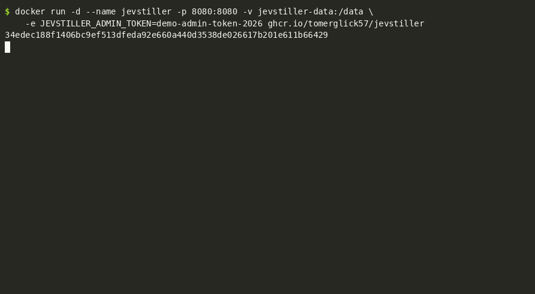

<p align="center">
  <a href="https://jevstiller.pages.dev"><picture>
    <source media="(prefers-color-scheme: dark)" srcset="https://github.com/tomerglick57/Jevstiller/raw/main/brand/jevstiller-logo-dark.svg">
    
  </picture></a>
</p>

<p align="center"><b>Jev, distilled on the fly.</b> Same call. Same answers. Your hardware.</p>

<p align="center">
  <a href="https://pypi.org/project/jevstiller/"></a>
  <a href="https://pypi.org/project/jevstiller/"></a>
  <a href="https://github.com/tomerglick57/Jevstiller/actions/workflows/ci.yml"></a>
  <a href="https://github.com/tomerglick57/Jevstiller/pkgs/container/jevstiller"></a>
  <a href="LICENSE"></a>
  <a href="https://jevstiller.pages.dev"></a>
</p>

Put Jevstiller in front of a repeated [Jev](https://docs.typesafe.ai) classification call. At first every request still goes to Jev. From Jev's own answers — with their full probability distributions — it trains a small local model on your traffic, checks that the model agrees with Jev within a budget you set, and then answers most requests itself. Uncertain or novel input, and a permanent random audit slice, keep going to Jev. Every request answered locally is a Jev call you don't pay for, one that can't hit a rate limit, and an answer in ~15 ms instead of ~300 ms.

<picture>
  <source media="(prefers-color-scheme: dark)" srcset="https://github.com/tomerglick57/Jevstiller/raw/main/docs/media/flow-dark.svg">
  
</picture>



You already call Jev. Run Jevstiller next to your service and point the SDK at it; nothing else changes:

```bash
docker run -d -p 8080:8080 -v jevstiller-data:/data ghcr.io/tomerglick57/jevstiller
export TYPESAFE_BASE_URL=http://localhost:8080     # your service keeps its own TYPESAFE_API_KEY
```

The recording above is [examples/proxy_demo.py](examples/proxy_demo.py): 5,000 real customer messages through the unmodified SDK, 8 threads, against live Jev. The local model took over after about 4,000 requests. `docker exec jevstiller jevstiller admin status <task>` shows the audit agreement behind it (with `-e JEVSTILLER_ADMIN_TOKEN=...` on the container).

## Why

Jev is fast, cheap and typed. It is also ~300 ms away, per answer, at every load we tried (16 to 64 concurrent callers, up to 190 requests/s, p50 300 ms), and it is hosted: every classification is a network call to one vendor, under published rate limits (80 requests and 100,000 tokens a second as of October 2026; 1,200 requests a minute at launch) that TypeSafe adjusts at its own discretion. Jevstiller is for the workload where that hurts: decisions made one after another (an agent loop, a game tick, classify-then-act pipelines), latency budgets in milliseconds, boxes with no egress, or simply not wanting every classification to depend on one external API.

On Banking77 (77 customer-support intents), replayed against Jev's recorded answers with the default settings, the local model answered **61.7% of held-out messages at 99.40% agreement with Jev** (target 98%), about 60% of traffic from 5,000 messages on, and kept Jev's accuracy (78.8% vs Jev's 78.5% on the dataset's labels). The live run of 2026-09-25, below, gave 70.7% at 99.45% with `rare_classes = "wait"`, the default then, which starts later and ends higher ([benchmarks](docs/benchmarks.md#rare-classes-defer-or-wait)). A local answer takes ~15 ms on CPU (p50), about 20× faster than Jev; one CPU process answers ~130 messages/s, a GPU ~2,000/s.¹

<picture>
  <source media="(prefers-color-scheme: dark)" srcset="https://github.com/tomerglick57/Jevstiller/raw/main/docs/media/results-dark.svg">
  
</picture>

## Benchmark

<!-- bench:start -->
Five public tasks, replayed through the loop with Jev's recorded answers as the teacher (bge-small on CPU, target agreement 98%). Answered locally and agreement are measured on 2,000 held-out rows against Jev; accuracy is against the dataset's own labels, for Jev alone and for the system (student where it answers, Jev elsewhere).

| Task | Answered locally | Agreement with Jev | Accuracy, Jev / system |
|---|---:|---:|---:|
| Banking77, 77 intents | **61.7%** | **99.40%** | 78.5% / 78.8% |
| CLINC150, 150 intents | **65.1%** | **99.65%** | 90.1% / 90.2% |
| AG News, 4 sections | **74.2%** | **99.75%** | 88.7% / 88.6% |
| TweetEval sentiment, 3 classes | **19.3%** | **98.80%** | 64.2% / 64.5% |
| TweetEval offensive, 2 classes | **21.3%** | **99.55%** | 73.8% / 73.8% |

Over 100 random splits across the 5 tasks, the calibrated threshold exceeded the 2% budget once; the usual point-estimate rule exceeded it on 6–12 of 20 splits per task.
<!-- bench:end -->

Coverage tracks how consistent Jev itself is on a task, not how hard the task is: on the tweets Jev agrees with the dataset's labels only 64% and 74% of the time, so the student answers the confident quarter and forwards the rest, and the system's accuracy still matches Jev's. The threshold-rule comparison, what other targets buy, and the one-command reproduction: [docs/benchmarks.md](docs/benchmarks.md#benchmark).

## The contract

You set one number. Jevstiller returns the label Jev would have returned on at least that share of requests:

```text
target_agreement = 0.98      →  disagreement budget = 2% of all requests
```

The routing threshold is chosen on a held-out, IID calibration set so that, with 95% confidence, the share of requests the local model answers *and* gets different from Jev stays within the budget. It uses an exact finite-sample bound (Clopper–Pearson), testing candidate thresholds strictest-first. It is not tuned by eye, and it is re-verified forever on the audit channel. If the audit shows the contract is broken, everything falls back to Jev automatically.

If your code also acts on Jev's `confidence`, for example sending answers below 0.6 to review, set that number as the task's `confidence_floor`. The bound then also counts the requests Jev would have been less sure about than that, and local answers report at least that confidence. See [configuration](docs/configuration.md).

**Agreement with Jev is not accuracy.** If Jev is wrong, the student is wrong the same way. The status report says so next to every number. See [DESIGN.md §2](DESIGN.md).

## Install

Before you put it in front of your Jev key, read [TypeSafe's terms](#typesafes-terms).

```bash
pip install jevstiller                 # everything: the proxy (`jevstiller serve`), the encoder, the Jev adapter
pip install "jevstiller[gpu]"          # on a GPU machine: adds PyTorch, used automatically when CUDA is present
```

Python 3.10+. CPU works out of the box; a GPU only speeds up the encoder.

## Drop-in proxy: no code changes

Run Jevstiller next to your services and point the Jev SDK at it:

```bash
docker run -d -p 8080:8080 -v jevstiller-data:/data ghcr.io/tomerglick57/jevstiller:0.6.0
# or: pip install jevstiller && jevstiller serve --config deploy/jevstiller.toml
```

```bash
export TYPESAFE_BASE_URL=http://jevstiller:8080     # in each calling service; nothing else changes
```

Services keep their own `TYPESAFE_API_KEY`; Jevstiller forwards it and never stores it.
- **Tasks:** every `Choice` question, and every yes/no (`Noul`) question, becomes a task, keyed by its exact instructions, criteria and model, so services asking the same question share one local model. For a yes/no question you state the cut-off your code uses (0.5 unless set): [docs/coverage.md](docs/coverage.md).
- **Until a student is ready:** requests are forwarded to Jev unchanged, and Jev's responses returned unchanged, until a task's student is trained and has passed its checks.
- **After that:** the proxy answers what it is sure about in Jev's exact response format (`x-jevstiller-source: local` tells you which), but only for keys Jev has accepted.
- **Always forwarded:** `Score` questions, other endpoints, and anything it does not understand.

Performance of one process (16 vCPU, bge-small on CPU, [docs/benchmarks.md](docs/benchmarks.md)):
- **Forwarded requests:** Jev's latency plus ~1–4 ms, and up to ~585 req/s at 256 concurrent callers.
- **Local answers:** ~16 ms p50, ~50 ms p99, up to the encoder's capacity (here ~150–340 texts/s depending on text length; a GPU raises it). Beyond that, the excess is forwarded to Jev, so the proxy is never much slower than Jev.
- **Memory:** ~300 MB with the encoder, plus a few MB per loaded task. Bounded over a 12-hour soak of 0.4.0 at 100 requests/s with ~16 task reloads a second: 300–445 MB throughout, 357 MB at the end, 4.3 million requests with no errors (and a 24-hour run of an earlier build: one hump to 654 MB that receded on its own).

Operations: a TOML config, an admin API and CLI (`jevstiller admin ...`), Prometheus `/metrics`, `/readyz`, JSON logs, `jevstiller backup`, and a Docker image and Kubernetes manifest. Docs: [deploy](docs/deploy.md), [operations](docs/operations.md), [the proxy](docs/proxy.md), [configuration](docs/configuration.md), [security](docs/security.md), [compatibility](docs/compatibility.md). Website: [jevstiller.pages.dev](https://jevstiller.pages.dev).

## How it compares
<!-- title: How Jevstiller compares with stuntd, TRACER, Distil Labs, routers, caches and open Jev models -->
<!-- description: Where Jevstiller differs from stuntd (the closest project), from TRACER, from Distil Labs and cloud distillation, from LLM routers and semantic caches, from open Jev-compatible models, and from the research it builds on, with a detailed page for each of the first three. -->

As of October 2026. The first three have a detailed page each.

- **[stuntd](https://github.com/bladedevoff/stuntd)** is the closest project. It is also a local Jev-compatible proxy that learns a head per question (on the Laya encoder or a stock sentence encoder) and checks 2% of live traffic. The differences ([in full](docs/compare/stuntd.md)):
  - **Guarantee:** Jevstiller picks its threshold with a finite-sample bound on disagreement over all requests; stuntd uses a point estimate on a holdout.
  - **Automation:** Jevstiller trains, shadow-tests and promotes by itself; stuntd uses `stuntd train` / `stuntd enable` by default, with opt-in `auto_retrain` and `auto_promote` settings.
  - **Training data:** Jevstiller learns from Jev's full probability distributions and gates unfamiliar inputs.
  - **Question identity:** Jevstiller identifies a question by its exact content; stuntd uses its name.
  - **Keys:** Jevstiller answers locally only for API keys Jev has accepted.
  - **Deployment:** Jevstiller serves many tenants from one server, on CPU.
  - **Where stuntd goes further:** it also speaks the OpenAI and Anthropic APIs, learns `score` questions, and can answer with no provider at all (zero-shot Laya).
- **[TRACER](https://github.com/adrida/tracer)** (MIT, [arXiv 2604.14531](https://arxiv.org/abs/2604.14531)) is a Python library that fits a classical-ML student on your LLM traces with a learned acceptance policy and certifies it once with a Clopper–Pearson lower bound on agreement among the requests it accepts. It takes any teacher and is not a proxy: your application embeds, routes and falls back. Jevstiller bounds disagreement over all requests, re-certifies on every retrain, and keeps a 2% audit on live traffic ([in full](docs/compare/tracer.md)).
- **[Distil Labs](https://www.distillabs.ai/) and cloud "distillation"** (Amazon Bedrock, OpenAI, Azure) post-train a small replacement model from your traffic as a separate job, then switch traffic to it. Distil Labs' endpoint falls back to your production model when the small one fails or times out, not when it is unsure; none of them states a bound, and none speaks Jev's API ([in full](docs/compare/distil-labs.md)).
- **Routers** (RouteLLM, Not Diamond, OpenRouter Auto) choose between existing models. **Semantic caches** (GPTCache, Portkey, [jevcache](https://github.com/hyperspaceai/jevcache)) reuse answers to near-identical inputs. Neither learns to answer new inputs.
- **Open Jev-compatible models** (Laya, Kev, jeff) replace Jev outright, at lower zero-shot accuracy.
- **Research:**
  - OCaTS (EMNLP 2023), Cache & Distil (ACL 2024) and Online Cascade Learning (ICML 2024) train a student online from an LLM's answers, without a guarantee.
  - BARGAIN (SIGMOD 2026) and vCache (ICLR 2026) guarantee agreement with the LLM, but without a student that keeps learning.
  - Jevstiller combines the two, with a permanent audit and automatic fallback on top.

## Quickstart (library)

Without a key, `python examples/quickstart_synthetic.py` runs the whole loop on CPU in half a minute with a synthetic teacher standing in for Jev. With Jev (`TYPESAFE_API_KEY` in your environment):

```python
from jevstiller import Task, Jevstiller, load_encoder
from jevstiller.teachers.jev import JevTeacher

task = Task(
    name="support_router",
    instructions="Which team should handle this customer message?",
    classes={                              # descriptions are sent to Jev verbatim — they are the spec
        "billing":      "Charges, invoices, refunds, payment methods",
        "technical":    "Bugs, errors, integrations, things not working",
        "cancellation": "Wants to cancel, downgrade, or close the account",
        "sales":        "Pre-sales questions, plan comparison, quotes",
        "other":        "Anything that does not fit the categories above",
    },
    target_agreement=0.98,
)

js = Jevstiller(task, teacher=JevTeacher(), data_dir="./jevstiller-data", encoder=load_encoder("base"))

r = js.classify("Please cancel my subscription")
r.label        # "cancellation"
r.confidence   # 0.97
r.source       # "teacher" at first — later "student:v9"

print(js.status().report())
```

```text
Task: support_router   version 89a7438c2f7d   mode: cascade   audit rate 2%
Production: student:v9   Shadow: -
Requests: 11,083   student 69.8%   teacher 30.2%
Agreement with teacher (audit, n=415): 99.40% [98.46%, 99.84%]   target 98%   OK
  note: agreement with the teacher is not accuracy.
```

## How it works

<picture>
  <source media="(prefers-color-scheme: dark)" srcset="https://github.com/tomerglick57/Jevstiller/raw/main/docs/media/loop-dark.svg">
  
</picture>

- **Encoder**: frozen sentence encoder (`bge-small/base/large`), ONNX or PyTorch. Embeddings are stored, so retraining never re-encodes.
- **Student**: numpy logistic regression on the teacher's *distribution*, early-stopped on a validation slice.
- **OOD gate**: kNN distance in embedding space — unlike anything seen → Jev, whatever the head says.
- **Audit channel**: a fixed random slice always goes to Jev. The only unbiased view of production, and the price of the guarantee.
- **Versions**: immutable `student:vN` directories; promote, roll back, or `export()` a standalone bundle.

The full reasoning — including the five loop bugs the first real replay found and how they were fixed — is in [DESIGN.md](DESIGN.md).

## Status

Alpha. Validated against live Jev (above).
- **Proxy:** the drop-in proxy works end to end with the unmodified TypeSafe SDK.
- **Security:** three security audits (12, 15 and 8 findings, all fixed: [docs/security.md](docs/security.md)).
- **Deployment:** it runs as a hardened container.
- **Tested under failure and load:**
  - Jev down, slow or rate limiting.
  - A full disk.
  - `kill -9` during training.
  - A 24-hour soak with a silent change in Jev's answers at hour 12, which it recovers from by itself (3.6 million requests, 0.012% errors).
  - Load up to 256 concurrent callers.

  Results: [docs/benchmarks.md](docs/benchmarks.md).
- **Benchmarked on five public tasks** against Jev's recorded answers ([above](#benchmark)); the full tables and the one-command reproduction are in [docs/benchmarks.md](docs/benchmarks.md#benchmark).

See [DEPLOYMENT_PLAN.md](DEPLOYMENT_PLAN.md) for what is done and what is next.

Documentation:
- [DESIGN.md](DESIGN.md): why it works the way it does.
- [docs/deploy.md](docs/deploy.md), [docs/operations.md](docs/operations.md), [docs/proxy.md](docs/proxy.md), [docs/coverage.md](docs/coverage.md) (what is answered locally of Jev's API, and what isn't), [docs/configuration.md](docs/configuration.md), [docs/benchmarks.md](docs/benchmarks.md), [docs/security.md](docs/security.md), [docs/compatibility.md](docs/compatibility.md) (supported SDK and Jev versions, what callers see, versioning).

Not for: tasks with changing class lists (retrain from scratch), non-text input, or volumes too low to ever collect a few thousand examples.

## Reproduce the numbers

Jev's answers for every Banking77 message ship with the repository, so the headline result replays without an API key:

```bash
git clone https://github.com/tomerglick57/Jevstiller && cd Jevstiller && pip install jevstiller
bash experiments/reproduce.sh      # the Banking77 result above, on CPU, 10-15 minutes: 61.7% coverage at 99.40% agreement, deterministic
```

```bash
python experiments/run.py --dataset banking77 --teacher jev --encoder small     # against live Jev (TYPESAFE_API_KEY)
python experiments/run.py --dataset banking77 --teacher oracle --encoder base   # the dataset's labels as a perfect teacher
```

See [experiments/README.md](experiments/README.md).

## TypeSafe's terms
<!-- title: TypeSafe's terms and Jevstiller -->
<!-- description: TypeSafe's Master Customer Agreement §2.3(b) restricts training on Jev's output. What the clause says, why we read Jevstiller's small per-question classifiers as outside it, and why you should decide for your own deployment. -->

Jevstiller runs on your own Jev key and your own traffic, so TypeSafe's [Master Customer Agreement](https://typesafe.ai/legal/mca) applies to how you use it. Read it first. §2.3(b) says a customer may not use Jev's output to "perform model distillation, train a model to imitate the output of the Services, or develop (or to facilitate the development of) a similar or competing product or service", and §6(a) lets TypeSafe suspend access over a breach.

We don't believe Jevstiller does what that clause is about. Nothing it builds resembles Jev:
- Each local model is a small classifier (one linear layer over a frozen open-source sentence encoder) for **one** of your questions, trained only on your own requests and Jev's answers to them.
- It can't answer a question it hasn't seen many times, can't take new instructions, and is of no use outside your deployment.
- It isn't offered to anyone else, and it keeps sending Jev every request it isn't sure of, plus a permanent audit share.
- It never sends Jev a request your code didn't make. Every answer it learns from is one you asked for, paid for and used for your own purposes; there is no separate training traffic. The models are a generalizing cache over your own labels, not a harvest of Jev's behavior.

This is our reading, not legal advice, and TypeSafe hasn't reviewed it. If your Jev access matters to your business, check with TypeSafe or a lawyer before you deploy. Jevstiller is an independent project, not affiliated with or endorsed by TypeSafe.

## Questions and contributing

- **Questions**: [Discussions › Q&A](https://github.com/tomerglick57/Jevstiller/discussions/categories/q-a).
- **You ran it on a real task**: post the status report in [Discussions › Show and tell](https://github.com/tomerglick57/Jevstiller/discussions/categories/show-and-tell) or open a [result report](https://github.com/tomerglick57/Jevstiller/issues/new?template=result.md). This is the most useful thing you can do for the project.
- **Bugs**: [open an issue](https://github.com/tomerglick57/Jevstiller/issues/new?template=bug.md). PRs welcome; see [CONTRIBUTING.md](CONTRIBUTING.md).
- **Security**: see [SECURITY.md](SECURITY.md), not a public issue.

## Citing

If Jevstiller is part of research, cite it with the metadata in [CITATION.cff](CITATION.cff) (GitHub's "Cite this repository" button renders it as BibTeX or APA). The method is described in [A bound, not a threshold](https://jevstiller.pages.dev/posts/the-guarantee/) and [DESIGN.md](DESIGN.md); the prior art it builds on is listed under [How it compares](#how-it-compares).

## License

Apache 2.0 (see `LICENSE` and `NOTICE`). Jevstiller is an independent project and is not affiliated with, endorsed by, or supported by TypeSafe. "Jev" is their model; this tool only talks to its public API.

---
¹ Live run 2026-09-24: 11,083 replayed messages with 2,000 held out, `bge-small` on CPU; the GPU figure is from an oracle-teacher run with `bge-base` on an RTX 3090. Every number, with its command: [docs/benchmarks.md](docs/benchmarks.md).
